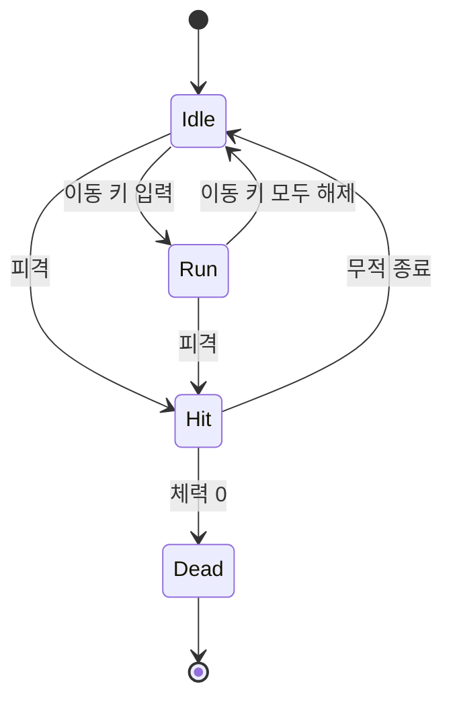
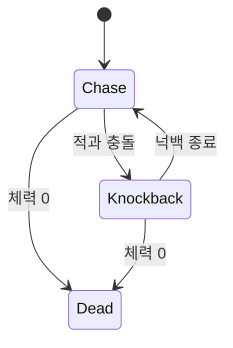
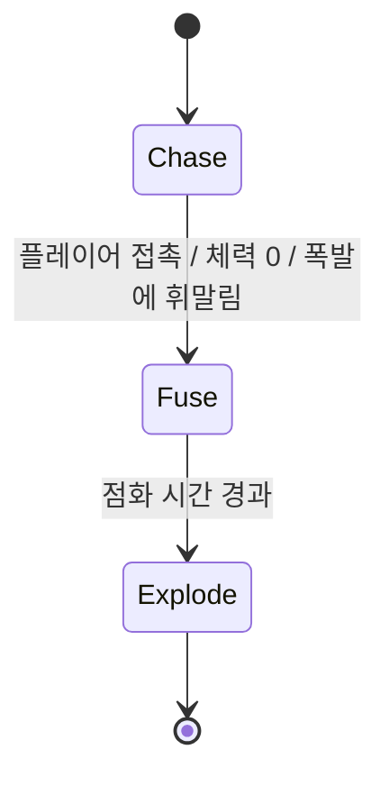
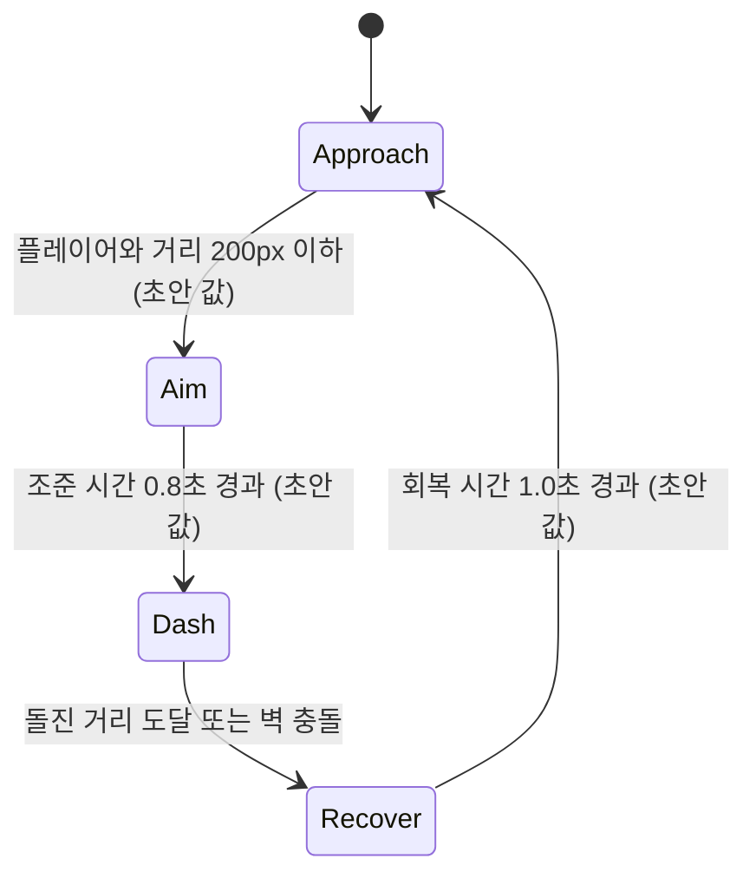

# SWAP ARENA

> 공격 버튼은 없다. 적과 자리를 바꿔, 적이 적을 쓰러뜨리게 만들어라.

| 항목      | 내용                                         |
| --------- | -------------------------------------------- |
| 장르      | 탑다운 아레나 서바이벌 (점수제, 무한 웨이브) |
| 개발 환경 | Python, pico2d                               |
| 개발 기간 | 1개월 (하루 1~2시간)                         |
| 개발 인원 | 1인                                          |

> 이 문서에 등장하는 수치 중 "초안 값"으로 표시된 것은 아직 확정되지 않은 값이며, 플레이 테스트를 거쳐 조정한다.

---

## 1. 게임 소개

**한 줄 컨셉:** 가장 가까운 적과 위치를 맞바꾸는 '스왑' 하나로 살아남는 아레나 서바이벌.

플레이어에게는 직접 공격하는 수단이 없다. 대신 3초마다 한 번, 가장 가까운 적과 순간적으로 위치를 바꾸는 '스왑'을 쓸 수 있다.
적들은 플레이어를 쫓아 몰려들고, 적끼리 부딪히면 서로 피해를 입는다. 폭발형 적은 터질 때 주변 폭발형 적까지 연쇄로 터뜨린다.
시간이 지날수록 적은 점점 많이 나타나며, 체력이 0이 될 때까지 최대한 높은 점수를 얻는 것이 목표다.

---

## 2. 핵심 재미와 차별화 포인트

### 스왑은 회피이자 공격이다

| 관점 | 스왑이 하는 일                                                                                                                  |
| ---- | ------------------------------------------------------------------------------------------------------------------------------- |
| 회피 | 적에게 포위되거나 돌진에 맞기 직전, 스왑으로 그 자리를 빠져나간다.                                                              |
| 공격 | 플레이어가 있던 자리는 적들이 몰려들던 지점이다. 그 자리에 적을 대신 놓으면, 몰려오던 적들이 그 적과 부딪혀 서로 피해를 입는다. |
| 연쇄 | 폭발형 적을 적 무리 한가운데로 보내면 폭발과 연쇄 폭발로 한 번에 많은 적을 정리할 수 있다.                                      |

즉, 플레이어가 하는 일은 "적을 때리는 것"이 아니라 **"적이 적을 공격하게 되는 위치를 만드는 것"**이다.
한 번의 입력이 회피와 공격을 동시에 해결하기 때문에, 언제 스왑할지와 스왑 전에 어디에 서 있을지가 곧 전략이 된다.

### 기존 탑다운 서바이벌과 다른 점

- **공격 버튼이 없다.** 일반적인 탑다운 서바이벌은 무기로 적을 직접 쓰러뜨리는 구조지만, 이 게임에서는 적끼리의 충돌과 폭발이 유일한 피해 수단이다.
- **대상 선택이 자동이다.** 스왑 대상은 항상 "가장 가까운 적"이다. 조준이 필요 없는 대신, 원하는 적이 가장 가깝게 오도록 이동으로 위치를 조절해야 한다.
- **조작이 2개뿐이다.** 이동과 스왑만으로 플레이가 완성되어 진입 장벽이 낮고, 판단에만 집중할 수 있다.
- **쿨타임 3초가 긴장감을 만든다.** 스왑을 아무 때나 쓸 수 없으므로, 쿨타임 동안은 이동만으로 버텨야 한다.

---

## 3. 조작법

| 입력                                  | 동작                                          |
| ------------------------------------- | --------------------------------------------- |
| 방향키 / W A S D                      | 8방향 이동                                    |
| Space                                 | 스왑 (가장 가까운 적과 위치 교환, 쿨타임 3초) |
| Enter / Space (타이틀, 게임오버 화면) | 게임 시작 / 재시작 (초안)                     |
| ESC                                   | 게임 종료 (초안)                              |

---

## 4. 게임 규칙

### 4-1. 스왑

- Space를 누르면 화면 안에서 **플레이어와 가장 가까운 적** 한 마리와 위치를 즉시 맞바꾼다.
- 쿨타임은 **3초**이며, 쿨타임 중에는 입력이 무시된다.
- 거리 비교는 두 객체 중심점 사이의 거리로 계산한다.
- 화면에 적이 없을 때 스왑을 누르면 아무 일도 일어나지 않으며, 쿨타임도 소모하지 않는다. (초안)
- 스왑 직후 플레이어에게 짧은 무적 시간을 준다: 0.3초 (초안 값)

### 4-2. 적끼리 충돌 피해

- 적과 적의 AABB가 겹치면 두 적 모두 피해를 입는다.
- 같은 두 적이 매 프레임 계속 피해를 주고받지 않도록, 충돌 후 서로 반대 방향으로 밀려나고 일정 시간 충돌 피해를 받지 않는다.
  - 충돌 피해량: 1 (초안 값)
  - 충돌 후 피해 면역 시간: 0.5초 (초안 값)

### 4-3. 폭발과 연쇄 폭발

- 폭발형 적은 다음 조건 중 하나를 만족하면 폭발한다.
  - 플레이어와 접촉
  - 다른 적과 충돌해 체력이 0이 됨
  - 다른 폭발에 휘말림
- 폭발 범위 안의 모든 적은 피해를 입고, 범위 안의 다른 폭발형 적은 **연쇄 폭발**한다.
- 폭발 범위 안에 플레이어가 있으면 플레이어도 피해를 입는다.
- 폭발 범위도 AABB(폭발 중심 기준 사각형)로 판정한다.
  - 폭발 범위: 반경 80px 사각형 (초안 값)
  - 폭발 피해량: 적 3, 플레이어 1 (초안 값)
  - 연쇄 폭발 지연: 0.1초 (초안 값, 연쇄가 눈에 보이도록 약간의 시차를 둔다)

### 4-4. 체력과 점수

| 항목              | 규칙                                                                                |
| ----------------- | ----------------------------------------------------------------------------------- |
| 플레이어 체력     | 3 (초안 값). 적과 접촉하거나 폭발에 휘말리면 1 감소                                 |
| 피격 무적         | 피격 후 1초간 무적 (초안 값)                                                        |
| 게임오버          | 체력이 0이 되면 게임오버                                                            |
| 점수: 생존        | 1초당 10점 (초안 값)                                                                |
| 점수: 처치        | 적 처치 시 100점 (초안 값)                                                          |
| 점수: 연쇄 보너스 | 연쇄 폭발로 처치한 적 1마리당 추가 50점 (초안 값)                                   |
| 최고 점수         | 게임오버 시 현재 점수가 최고 점수보다 높으면 파일에 저장하고, 다음 실행 시 불러온다 |

### 4-5. 스폰 증가 방식

- 적은 화면 가장자리의 무작위 위치에서 등장한다.
- 일정 간격마다 스폰 주기가 짧아지고, 등장하는 적 종류가 늘어난다.

| 경과 시간  | 스폰 간격                         | 등장 적                |
| ---------- | --------------------------------- | ---------------------- |
| 0 ~ 30초   | 2.0초                             | 추격형                 |
| 30 ~ 60초  | 1.6초                             | 추격형, 폭발형         |
| 60 ~ 120초 | 1.2초                             | 추격형, 폭발형, 돌진형 |
| 120초 이후 | 30초마다 0.1초씩 감소, 최소 0.5초 | 전체                   |

> 위 표의 시간, 간격, 최소값은 모두 초안 값이다. 화면에 동시에 존재할 수 있는 적 수의 상한(초안 값: 40마리)을 두어 성능 저하를 방지한다.

---

## 5. 적 설명

| 이름            | 행동 패턴                                                             | 특징                                                                                                        | 공략법                                                                                                 |
| --------------- | --------------------------------------------------------------------- | ----------------------------------------------------------------------------------------------------------- | ------------------------------------------------------------------------------------------------------ |
| 추격형 (Chaser) | 항상 플레이어를 향해 일정 속도로 직선 이동                            | 가장 기본적인 적. 수가 많아 적 무리의 대부분을 차지한다. 체력 2 (초안 값)                                   | 여러 마리를 한쪽으로 끌고 다니다가 스왑해, 쫓아오던 무리가 서로 부딪히게 만든다.                       |
| 폭발형 (Bomber) | 플레이어를 향해 추격형보다 느리게 이동, 조건 충족 시 폭발             | 터지면 주변 적에게 큰 피해를 주고, 다른 폭발형을 연쇄 폭발시킨다. 플레이어에게도 위험하다. 체력 1 (초안 값) | 적 무리 근처에 있을 때 스왑해서 무리 한가운데 보낸다. 플레이어 근처에서 터지지 않도록 거리를 유지한다. |
| 돌진형 (Dasher) | 플레이어와 일정 거리에서 멈춰 조준한 뒤, 그 방향으로 빠르게 직선 돌진 | 돌진 중에는 방향을 바꾸지 않는다. 돌진 경로 위의 적과 부딪히면 그 적에게 피해를 준다. 체력 3 (초안 값)      | 조준 중에 다른 적을 돌진 경로에 놓이게 하거나, 돌진 직전에 스왑을 써서 피한다.                         |

---

## 6. 게임 흐름

```
┌──────────┐   시작 입력    ┌──────────┐   체력 0    ┌──────────┐
│  타이틀  │ ─────────────> │  플레이  │ ──────────> │ 게임오버 │
└──────────┘                └──────────┘             └──────────┘
     ^                           ^                        │
     │                           │       재시작 입력      │
     │                           └────────────────────────┤
     │                 타이틀로 (초안)                    │
     └────────────────────────────────────────────────────┘
```

| 화면     | 내용                                                    |
| -------- | ------------------------------------------------------- |
| 타이틀   | 게임 제목, 최고 점수, 시작 안내 문구 표시               |
| 플레이   | 아레나, 플레이어, 적, 체력, 현재 점수, 스왑 쿨타임 표시 |
| 게임오버 | 최종 점수, 최고 점수, 신기록 여부, 재시작 안내 표시     |
| 재시작   | 게임 월드를 초기화하고 플레이 화면으로 돌아간다         |

---

## 7. 기술 설계

### 7-1. 폴더 구조

```
SWAP_ARENA/
├── main.py                 # 진입점, 첫 모드(타이틀) 실행
├── game_framework.py       # 모드 전환 및 메인 루프
├── game_world.py           # 오브젝트 레이어 관리, 충돌 쌍 등록
├── state_machine.py        # 상태 패턴 공용 클래스
├── config.py               # 초안 값(속도, 체력, 쿨타임 등) 모음
├── modes/
│   ├── title_mode.py
│   ├── play_mode.py
│   └── gameover_mode.py
├── objects/
│   ├── player.py
│   ├── enemy.py            # Enemy 기본 클래스
│   ├── chaser.py           # 추격형
│   ├── bomber.py           # 폭발형
│   ├── dasher.py           # 돌진형
│   ├── explosion.py        # 폭발 판정 오브젝트
│   └── background.py
├── systems/
│   ├── collision.py        # AABB 판정
│   ├── spawner.py          # 시간 기반 적 생성
│   └── score.py            # 점수 계산, 최고 점수 저장/불러오기
├── resource/
│   ├── image/              # 캐릭터, 적 3종, 배경
│   └── font/
└── data/
    └── highscore.json      # 최고 점수 저장 파일
```

### 7-2. 주요 클래스와 역할

| 클래스 / 모듈  | 역할                                                                                                      |
| -------------- | --------------------------------------------------------------------------------------------------------- |
| `Player`     | 입력 처리, 이동, 스왑 쿨타임 관리, 체력과 무적 시간 관리, 상태 머신 보유                                  |
| `Enemy`      | 모든 적의 기본 클래스. 위치, 체력, 속도, 충돌 피해 면역 타이머, 바운딩 박스, 피해 처리 공통 담당 |
| `Chaser`     | `Enemy` 상속. 플레이어 방향 추격                                                                        |
| `Bomber`     | `Enemy` 상속. 추격 후 조건 충족 시 `Explosion` 생성                                                   |
| `Dasher`     | `Enemy` 상속. 접근, 조준, 돌진, 회복 상태 순환                                                          |
| `Explosion`  | 짧은 시간 존재하는 판정 오브젝트. 범위 내 적에게 피해, 폭발형이면 연쇄 폭발 유발                          |
| `collision`  | 두 객체의 AABB 겹침 판정                                                                              |
| `game_world` | 레이어별 오브젝트 목록, 충돌 그룹(플레이어-적, 적-적, 폭발-적, 폭발-플레이어) 관리                        |
| `Spawner`    | 경과 시간에 따라 스폰 간격과 적 종류를 결정하고 화면 가장자리에 적 생성                                   |
| `Score`      | 생존 시간 점수, 처치 점수, 연쇄 보너스 계산. 최고 점수 파일 입출력                                        |

### 7-3. 상태 패턴 설계

플레이어와 각 적은 `StateMachine`을 가지며, 각 상태는 진입, 종료, 매 프레임 갱신, 그리기 동작을 가진다.

#### 플레이어



| 상태 | 동작                                         | 전이                                    |
| ---- | -------------------------------------------- | --------------------------------------- |
| Idle | 정지, 대기 애니메이션                        | 이동 키 입력 시 Run, 피격 시 Hit        |
| Run  | 입력 방향으로 이동                           | 키 해제 시 Idle, 피격 시 Hit            |
| Hit  | 깜빡임 표시, 무적. 이동은 가능               | 무적 시간 종료 시 Idle, 체력 0이면 Dead |
| Dead | 입력 무시, 사망 연출 후 게임오버 모드로 전환 | -                                       |

> 스왑은 순간적으로 끝나는 동작이므로 별도 상태로 두지 않고, Idle / Run / Hit 어느 상태에서든 쿨타임만 충족하면 실행되는 행동으로 처리한다.

#### 추격형 (Chaser)



#### 폭발형 (Bomber)



| 상태    | 동작                                                               |
| ------- | ------------------------------------------------------------------ |
| Chase   | 플레이어 추격                                                      |
| Fuse    | 이동 정지, 점멸 표시. 점화 시간: 0.1초 (초안 값, 연쇄 지연과 동일) |
| Explode | `Explosion` 오브젝트 생성 후 자신 제거                           |

#### 돌진형 (Dasher)



| 상태     | 동작                                                                |
| -------- | ------------------------------------------------------------------- |
| Approach | 플레이어 쪽으로 이동                                                |
| Aim      | 정지, 조준 방향 표시. 조준 시작 시점의 플레이어 위치를 목표로 고정  |
| Dash     | 고정된 방향으로 고속 직선 이동. 경로 위 적과 충돌 시 그 적에게 피해 |
| Recover  | 정지 후 다시 접근                                                   |

> 모든 적은 공통으로 체력이 0이 되면 Dead 처리되어 `game_world`에서 제거된다. (폭발형은 Dead 대신 Fuse로 전이)

---

## 8. 개발 일정

하루 1~2시간 기준, 총 작업 시간은 약 30~60시간으로 잡는다. 그래픽은 1~3주차 동안 임시 도형(사각형, 원)으로 개발하고, 4주차에 AI 이미지 생성 툴로 만든 리소스로 교체한다.

### 1주차: 기본 뼈대와 스왑

- [ ] 프로젝트 구조, `game_framework`, `game_world`, `state_machine` 구성
- [ ] 타이틀 / 플레이 / 게임오버 모드 전환
- [ ] 플레이어 이동 (방향키, WASD), Idle / Run 상태
- [ ] 추격형 적 1종 (임시 도형)
- [ ] AABB 충돌 판정 함수
- [ ] 가장 가까운 적 탐색과 스왑, 쿨타임 3초

### 2주차: 핵심 규칙 완성

- [ ] 적끼리 충돌 피해, 넉백, 피해 면역 시간
- [ ] 플레이어 체력, 피격, 무적, Dead 상태
- [ ] 폭발형 적과 `Explosion` 오브젝트
- [ ] 연쇄 폭발
- [ ] 시간 기반 스포너 (스폰 간격 감소)

### 3주차: 적 완성과 점수 시스템

- [ ] 돌진형 적 (Approach / Aim / Dash / Recover)
- [ ] 점수 계산 (생존, 처치, 연쇄 보너스)
- [ ] 최고 점수 파일 저장 / 불러오기
- [ ] UI: 체력, 점수, 스왑 쿨타임 표시
- [ ] 1차 밸런스 조정 (초안 값 수정)

### 4주차: 그래픽 교체와 마무리

- [ ] AI 이미지 생성 툴로 캐릭터 1종, 적 3종, 배경 제작
- [ ] 임시 도형을 이미지로 교체, 바운딩 박스 크기 재조정
- [ ] 타이틀, 게임오버 화면 정리
- [ ] 2차 밸런스 조정, 버그 수정
- [ ] README 최신화, 플레이 영상 또는 스크린샷 추가

---

## 9. 위험 요소와 대응 방안

| 위험 요소                                           | 영향                                       | 대응 방안                                                                                                             |
| --------------------------------------------------- | ------------------------------------------ | --------------------------------------------------------------------------------------------------------------------- |
| 적끼리 겹친 상태로 매 프레임 피해를 주고받음        | 적이 순식간에 사라져 의도와 다른 결과 발생 | 충돌 시 넉백과 피해 면역 시간 적용                                                                                    |
| 연쇄 폭발 시 같은 프레임에서 리스트 수정            | 순회 중 삭제로 인한 오류, 무한 연쇄        | 폭발은 다음 프레임에 처리하고, 이미 폭발 처리된 적은 플래그로 중복 방지. 삭제는 프레임 끝에 일괄 처리                 |
| 적 수 증가로 인한 충돌 검사 부하 (적-적 검사는 N^2) | 후반부 프레임 저하                         | 동시 적 수 상한 설정. 부족하면 화면을 격자로 나눠 근처 적끼리만 검사 (확장 요소)                                      |
| 스왑이 너무 강하거나 약함                           | 게임이 지나치게 쉽거나 어려움              | 수치를 `config.py`에 모아 두고 3, 4주차에 플레이 테스트로 조정                                                      |
| 스왑 위치가 다른 적과 겹쳐 즉시 피격                | 스왑했는데 바로 맞는 불합리한 경험         | 스왑 직후 짧은 무적 시간 부여                                                                                         |
| AI 생성 이미지의 스타일 불일치, 크기 불일치         | 그래픽 완성도 저하, 판정과 이미지 불일치   | 같은 프롬프트 스타일 유지, 이미지와 별개로 바운딩 박스 크기를 `config.py`에서 관리. 실패 시 임시 도형을 다듬어 유지 |
| 일정 지연 (하루 1~2시간의 제한된 작업 시간)         | 4주 안에 미완성                            | 1~2주차에 핵심 규칙(스왑, 충돌 피해, 연쇄 폭발)을 우선 완성. 확장 요소는 일정 여유가 있을 때만 진행                   |

---

## 확장 요소

아래 항목은 1개월 범위에 포함하지 않으며, 핵심 기능이 완성되고 일정에 여유가 있을 때만 검토한다.

- 효과음과 배경음악
- 스왑, 폭발 시 화면 흔들림과 파티클 효과
- 콤보 시스템 (짧은 시간 내 연속 처치 시 점수 배율)
- 격자 분할을 이용한 충돌 검사 최적화
- 적 종류 추가 또는 보스 웨이브
- 난이도 선택
- 최고 점수 상위 여러 개 기록 (랭킹)
